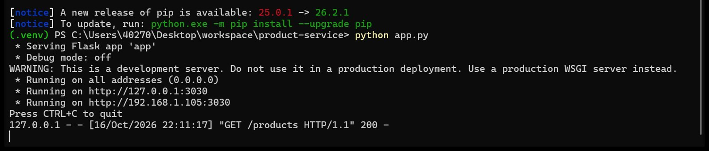
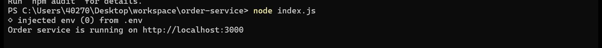
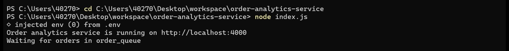
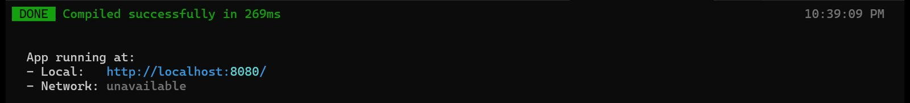
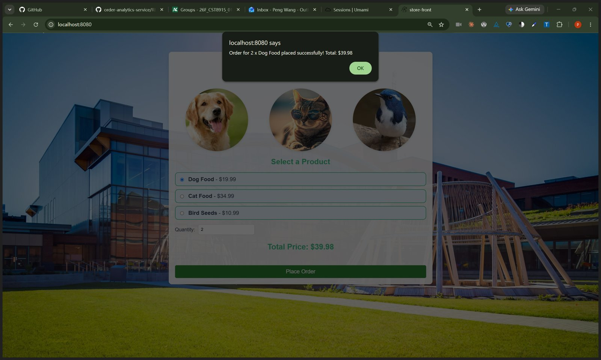
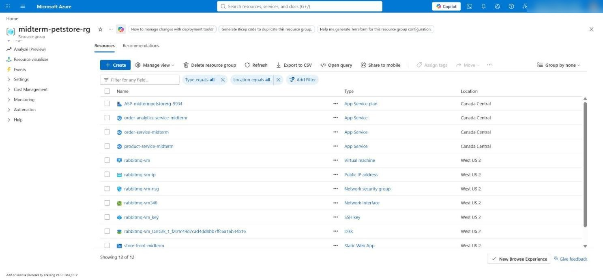
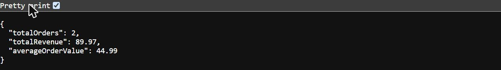
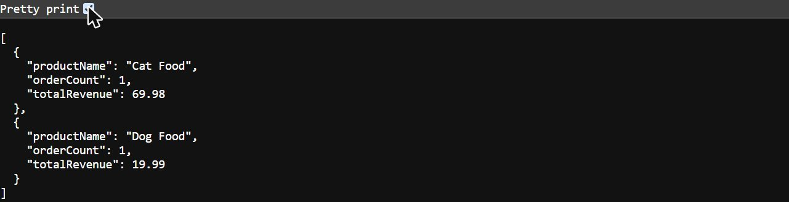
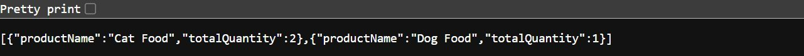
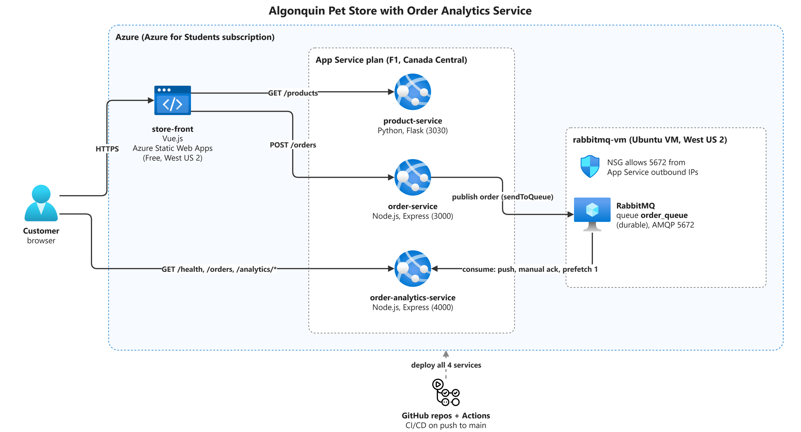

# Order Analytics Service

CST8915 Midterm Project: a new service for the Algonquin Pet Store that consumes orders from the RabbitMQ queue `order_queue` and serves analytics over REST.

## Demo video

YouTube (unlisted): _link to be added after recording_

## 1. A brief overview of your order-analytics-service (language choice, architecture decisions)

**Language:** Node.js with Express, the same stack as `order-service`, and Azure App Service has a built-in Node runtime.

| Endpoint | Returns |
| --- | --- |
| `GET /health` | Service status and RabbitMQ connection state |
| `GET /orders` | All consumed orders |
| `GET /analytics/summary` | Total orders, total revenue, average order value |
| `GET /analytics/products` | Order count and revenue per product |
| `GET /analytics/top-products` | Top 3 products by quantity sold |

**Architecture decisions:**

- In-memory storage. As the project requirements say: "Use one application instance and one consumer process when using in-memory storage so all orders and analytics are held in the same process." The data resets after a restart.

**12-Factor App Compliance:**

| Factor | Requirement | How this service does it |
| --- | --- | --- |
| **I. Codebase** | Own GitHub repository for the order-analytics-service | https://github.com/peng2026-cloud/order-analytics-service |
| **II. Dependencies** | All dependencies declared in a manifest file (`package.json`, `requirements.txt`, etc.) | `package.json` |
| **III. Config** | RabbitMQ connection string and port configured via environment variables / `.env` file | `RABBITMQ_CONNECTION_STRING` and `PORT` |
| **IV. Backing Services** | RabbitMQ treated as an attached resource via connection string | Docker locally, the Azure VM on Azure, same code |

## 2. The RabbitMQ consumer pattern you chose and why

I chose a **push consumer**. RabbitMQ sends each order to my service as soon as the order arrives in the queue.

| Option | How it works | Why I chose it or not |
| --- | --- | --- |
| Pull (`channel.get`) | My service would keep asking the queue whether there is a new order. | I did not choose it. The service would keep asking even when the queue is empty, and a new order would wait until the next time the service asks. |
| Publish/subscribe | RabbitMQ would copy each order to every service that subscribes. | I did not choose it. Only my service needs the orders, so there is nothing to copy. |
| **Push (`channel.consume`)** | RabbitMQ sends each order to my service as soon as it arrives. | **I chose it.** My service does not need to keep asking, and it gets each order right away. |

My service tells RabbitMQ that an order is done (an acknowledgement) only after it has saved the order ([index.js](index.js#L46-L64)). If the service stops before that, RabbitMQ puts the order back in the queue, so no order is lost.

## 3. A live demo of the application running locally: place orders, then show analytics endpoints

RabbitMQ runs in Docker (`rabbitmq:4-management`), and each service runs in its own terminal tab.

product-service on port 3030:

order-service on port 3000:

order-analytics-service on port 4000, connected to RabbitMQ:

store-front on port 8080:

Place orders at http://localhost:8080, then check the analytics:

- http://localhost:4000/analytics/summary
- http://localhost:4000/analytics/products
- http://localhost:4000/analytics/top-products

An order placed locally:

## 4. A live demo of the application running on Azure: show all deployed services, place orders, and verify analytics

| Component | Azure service | Region |
| --- | --- | --- |
| RabbitMQ | VM `rabbitmq-vm` | West US 2 |
| order-service | Azure App Service `order-service-midterm` | Canada Central |
| product-service | Azure App Service `product-service-midterm` | Canada Central |
| order-analytics-service | Azure App Service `order-analytics-service-midterm` | Canada Central |
| store-front | Azure Static Web Apps `store-front-midterm` | West US 2 |

Each service deploys from its GitHub repository with GitHub Actions. `RABBITMQ_CONNECTION_STRING` is an App setting, and the VM allows port 5672 only from the App Services.

Place orders at https://orange-meadow-0c22c891e.1.azurestaticapps.net, then check the analytics:

- https://order-analytics-service-midterm-heaeadakgxb8f3eh.canadacentral-01.azurewebsites.net/analytics/summary
- https://order-analytics-service-midterm-heaeadakgxb8f3eh.canadacentral-01.azurewebsites.net/analytics/products
- https://order-analytics-service-midterm-heaeadakgxb8f3eh.canadacentral-01.azurewebsites.net/analytics/top-products

The analytics on Azure after two orders:

## 5. A walkthrough of your architecture diagram

1. The customer opens `store-front` on Azure Static Web Apps.
2. The browser gets products from `product-service` and sends each order to `order-service`.
3. `order-service` publishes the order to the durable queue `order_queue` on the RabbitMQ VM.
4. `order-analytics-service` consumes the queue and serves the analytics endpoints.

## Service repositories

| Service | Repository |
| --- | --- |
| order-analytics-service | https://github.com/peng2026-cloud/order-analytics-service |
| order-service | https://github.com/peng2026-cloud/order-service |
| product-service | https://github.com/peng2026-cloud/product-service |
| store-front | https://github.com/peng2026-cloud/store-front |

## Contributions

| Member | Contribution |
| --- | --- |
| Peng Wang | Analytics service, local test, Azure deployment, architecture diagram, README |

## Use of AI

Claude (Anthropic) was used to help write and review the code, plan the Azure deployment and draft this README. All code was run and tested locally and on Azure, and the results were checked by hand.
