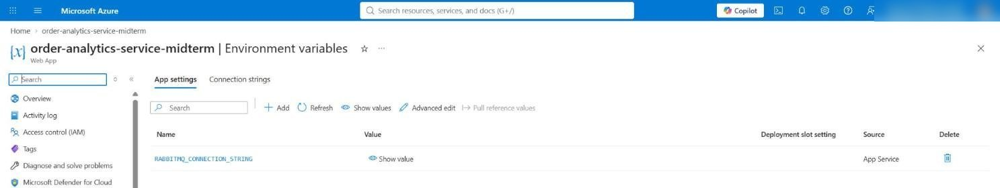
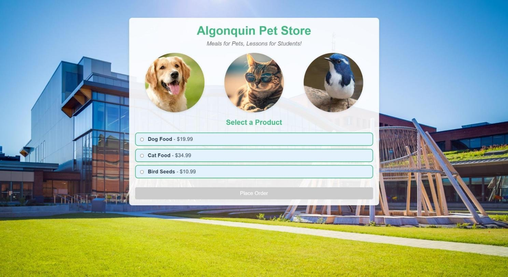

# Order Analytics Service

CST8915 Midterm Project: extends the Algonquin Pet Store with a service that consumes orders from the RabbitMQ queue `order_queue` (published by `order-service`) and serves analytics over REST. Node.js + Express, port 4000.

## Demo video

YouTube (unlisted): _link to be added after recording_

## Endpoints

| Method | Endpoint | Returns |
| --- | --- | --- |
| GET | `/health` | Service status and RabbitMQ connection state |
| GET | `/orders` | All consumed orders |
| GET | `/analytics/summary` | Total orders, total revenue, average order value |
| GET | `/analytics/products` | Order count and revenue per product |
| GET | `/analytics/top-products` | Top 3 products by quantity sold |

## 12-Factor App (I to IV)

| Factor | How |
| --- | --- |
| I. Codebase | This service has its own repository; each of the other services has its own too |
| II. Dependencies | Declared in `package.json`, locked in `package-lock.json` |
| III. Config | `RABBITMQ_CONNECTION_STRING` and `PORT` come from environment variables (`.env` locally, App settings on Azure); `.env.example` documents them |
| IV. Backing services | RabbitMQ is attached through the connection string only: Docker on localhost or the Azure VM, with no code change |

| Variable | Default | Meaning |
| --- | --- | --- |
| `RABBITMQ_CONNECTION_STRING` | `amqp://localhost` | RabbitMQ connection string |
| `PORT` | `4000` | HTTP port; App Service sets it automatically |

## RabbitMQ consumer pattern

**Choice:** a push consumer. RabbitMQ sends each order to the service as soon as it arrives.

| Option | How it works | Chosen? |
| --- | --- | --- |
| Pull (`channel.get`) | The service keeps asking the queue for new orders. | No: wasted requests when the queue is empty, and orders wait for the next check. |
| Publish/subscribe | Each order is copied to every subscribed service. | No: only this service needs the orders. |
| **Push (`channel.consume`)** | RabbitMQ sends each order to the service as soon as it arrives. | **Yes:** no polling, no delay. |

### How it works in the code

All of it is in `startConsumer()` in [index.js](index.js#L23-L70).

**1. Connect, and reconnect if RabbitMQ goes away** ([lines 25 to 33](index.js#L25-L33))

```js
const connection = await amqp.connect(RABBITMQ_CONNECTION_STRING);
connection.on('close', () => {
  setTimeout(startConsumer, RETRY_DELAY_MS);
});
```

The address comes from the environment, so the same code connects to Docker locally or to the VM on Azure. If the connection closes, the service tries again after 5 seconds.

**2. Use the same queue as order-service, one order at a time** ([lines 38 to 41](index.js#L38-L41))

```js
await channel.assertQueue(QUEUE, { durable: true });
await channel.prefetch(1);
```

`durable: true` must match `order-service`; a mismatch would make the declaration fail. A durable queue survives a RabbitMQ restart. `prefetch(1)` means RabbitMQ sends at most one unacknowledged order at a time, so after a failure at most one order is redelivered.

**3. Let RabbitMQ push each order, and acknowledge it only after it is stored** ([lines 46 to 64](index.js#L46-L64))

```js
await channel.consume(QUEUE, (msg) => {
  const order = JSON.parse(msg.content.toString());
  orders.push({ ...order, receivedAt: new Date().toISOString() });
  channel.ack(msg);
}, { noAck: false });
```

`channel.consume` registers a function that RabbitMQ calls for every new order, so the service never polls. With `noAck: false` (manual acknowledgement), RabbitMQ keeps the order until `channel.ack` runs; if the service stops before that, RabbitMQ requeues it, so no order is lost.

**4. Reject an invalid message instead of retrying it forever** ([line 62](index.js#L62))

```js
channel.nack(msg, false, false);
```

A message that is not valid JSON, or has no product name or numeric quantity, is rejected without requeue, so it cannot be redelivered again and again. It is discarded, because no dead-letter queue is configured.

Orders are stored in memory, as the project requirements permit. The service therefore runs as one instance with one consumer, and its data resets on restart.

## Run locally

Commands are for Windows PowerShell; each service runs in its own terminal tab. Prerequisites: Docker Desktop, Git, Node.js 20+ and Python 3.12. On macOS or Linux, use the two alternatives noted below.

All four repositories go in one folder:

```bash
mkdir petstore
```

```bash
cd petstore
```

### 1. RabbitMQ (Docker)

First time (creates the container; port 5672 for AMQP, 15672 for the management page):

```bash
docker run -d --name rabbitmq -p 5672:5672 -p 15672:15672 rabbitmq:4-management
```

Later runs:

```bash
docker start rabbitmq
```

Management page: http://localhost:15672 (user `guest`, password `guest`).

### 2. product-service (port 3030)

```bash
git clone https://github.com/peng2026-cloud/product-service.git
```

```bash
cd product-service
```

```bash
python -m venv .venv
```

Activate the virtual environment (macOS or Linux: `source .venv/bin/activate`):

```bash
.venv\Scripts\activate
```

```bash
pip install -r requirements.txt
```

```bash
python app.py
```

### 3. order-service (port 3000)

In a new terminal tab, in the `petstore` folder:

```bash
git clone https://github.com/peng2026-cloud/order-service.git
```

```bash
cd order-service
```

```bash
npm install
```

```bash
node index.js
```

It uses `amqp://localhost` by default.

### 4. order-analytics-service (port 4000)

In a new terminal tab, in the `petstore` folder:

```bash
git clone https://github.com/peng2026-cloud/order-analytics-service.git
```

```bash
cd order-analytics-service
```

```bash
npm install
```

```bash
npm start
```

It uses `amqp://localhost` and port 4000 by default, and prints `Waiting for orders in order_queue` once it is connected.

### 5. store-front (port 8080)

In a new terminal tab, in the `petstore` folder:

```bash
git clone https://github.com/peng2026-cloud/store-front.git
```

```bash
cd store-front
```

Point the store-front at the local APIs (macOS or Linux: `printf 'VUE_APP_ORDER_SERVICE_URL=http://localhost:3000\nVUE_APP_PRODUCT_SERVICE_URL=http://localhost:3030\n' > .env`):

```bash
"VUE_APP_ORDER_SERVICE_URL=http://localhost:3000", "VUE_APP_PRODUCT_SERVICE_URL=http://localhost:3030" | Set-Content .env
```

```bash
npm install
```

```bash
npm run serve
```

### 6. Test

1. Open http://localhost:8080 and place a few orders.
2. Check the analytics:
   - http://localhost:4000/health
   - http://localhost:4000/orders
   - http://localhost:4000/analytics/summary
   - http://localhost:4000/analytics/products
   - http://localhost:4000/analytics/top-products
3. Stop each service with Ctrl+C, then stop RabbitMQ:

```bash
docker stop rabbitmq
```

### Local test screenshots

product-service on port 3030:


order-service on port 3000:


order-analytics-service on port 4000, connected to RabbitMQ:


store-front on port 8080:


An order placed in the local store-front:


## Azure deployment

| Component | Azure service | Region |
| --- | --- | --- |
| RabbitMQ | VM `rabbitmq-vm` (Ubuntu 24.04, Standard_B2ls_v2) | West US 2 |
| order-service | App Service `order-service-midterm` (Node 24 LTS) | Canada Central |
| product-service | App Service `product-service-midterm` (Python 3.12) | Canada Central |
| order-analytics-service | App Service `order-analytics-service-midterm` (Node 24 LTS) | Canada Central |
| store-front | Static Web App `store-front-midterm` (Free) | West US 2 |

- The three App Services share one Free F1 Linux plan and deploy from GitHub Actions (Deployment Center, basic authentication).
- `RABBITMQ_CONNECTION_STRING` is an App setting on `order-service-midterm` and `order-analytics-service-midterm`.
- The VM's NSG allows port 5672 only from the App Services' possible outbound IP addresses.
- `store-front` builds with GitHub Actions; the workflow sets `VUE_APP_ORDER_SERVICE_URL` and `VUE_APP_PRODUCT_SERVICE_URL` to the App Service URLs.

### Azure screenshots

The resource group with the RabbitMQ VM, the three App Services and the Static Web App:


`RABBITMQ_CONNECTION_STRING` is an App setting, not code (value hidden):



The deployed store-front (https://orange-meadow-0c22c891e.1.azurestaticapps.net):



Analytics on Azure after two orders (Cat Food x 2, Dog Food x 1):


## Architecture


Source: [docs/architecture.drawio](docs/architecture.drawio)

1. The customer opens `store-front` (Vue.js on Azure Static Web Apps). The browser calls the APIs directly; their URLs come from the `VUE_APP_` variables set in the build workflow.
2. `GET /products` goes to `product-service`; `POST /orders` goes to `order-service`.
3. `order-service` publishes each order as JSON to the durable queue `order_queue` on RabbitMQ (default exchange, `sendToQueue`).
4. `order-analytics-service` consumes the queue, stores the orders in memory and serves the analytics endpoints.

## Service repositories

| Service | Repository |
| --- | --- |
| order-analytics-service | https://github.com/peng2026-cloud/order-analytics-service (this repo) |
| order-service | https://github.com/peng2026-cloud/order-service |
| product-service | https://github.com/peng2026-cloud/product-service |
| store-front | https://github.com/peng2026-cloud/store-front |

## Challenges and lessons learned

- **Regions:** the Azure for Students policy allows only a few regions, and Static Web Apps defaults to East US 2, which failed validation; West US 2 works. The VM is in West US 2 because B-series v2 sizes are available there, and the App Services are in Canada Central because the F1 quota in West US 2 is 0.
- **App Service outbound IPs:** RabbitMQ must allow every address in `possibleOutboundIpAddresses`, not only the current `outboundIpAddresses`.
- **Free tier sleep:** F1 apps idle out, which clears the in-memory analytics, so the service is warmed up before a demo.

## Contributions

| Member | Contribution |
| --- | --- |
| Peng Wang | Analytics service, local integration test, Azure deployment (VM, App Services, Static Web App), architecture diagram, README |

## Use of AI

Claude (Anthropic) was used to help write and review the service code, draw the architecture diagram and draft this README. All code was run and tested locally and on Azure, and the results were checked by hand.
